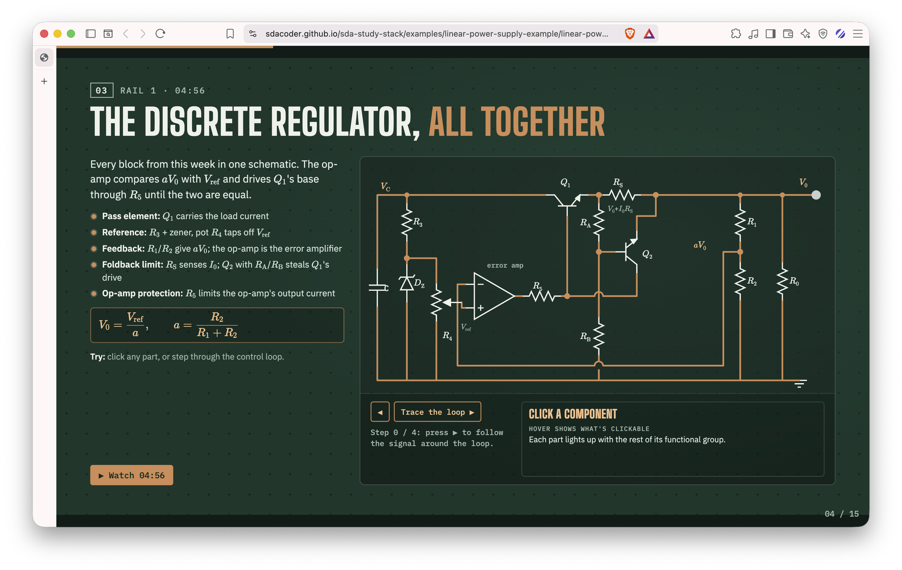
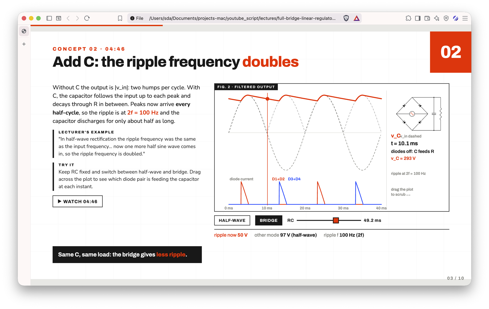

# sda-study-stack

Claude skills for studying: turn the lectures you're learning from into material you can interact with.

## Skills

| Skill | What it does |
| --- | --- |
| [`youtube-lecture-visualizer`](skills/youtube-lecture-visualizer/) | Turns a YouTube lecture into an interactive HTML slide deck. It fetches the transcript, adds supporting material from the web, designs a hands-on widget for each concept (sliders, step-throughs, clickable diagrams), and builds the deck with a quiz and recap. Every concept slide links back to the moment it's taught in the video. |

## Examples

Finished decks you can open in the browser (use the arrow keys to move between slides):


*From the Linear power supply (example) deck: click any component, or step through the control loop.*


*From a full-bridge rectifier deck: switch between half-wave and bridge, drag the RC slider, and scrub the plot.*

| Example | Live deck | Source |
| --- | --- | --- |
| Supervised learning intro | [Open deck](https://sdacoder.github.io/sda-study-stack/examples/supervised-learning-intro/supervised-learning-intro.html) | [`examples/supervised-learning-intro/`](examples/supervised-learning-intro/) |
| Linear power supply | [Open deck](https://sdacoder.github.io/sda-study-stack/examples/linear-power-supply/linear-power-supply.html) | [`examples/linear-power-supply/`](examples/linear-power-supply/) |
| Linear power supply (example) | [Open deck](https://sdacoder.github.io/sda-study-stack/examples/linear-power-supply-example/linear-power-supply-example.html) | [`examples/linear-power-supply-example/`](examples/linear-power-supply-example/) |

## Install

```bash
npx skills add https://github.com/sDaCoder/sda-study-stack --skill youtube-lecture-visualizer
```

Or copy `skills/youtube-lecture-visualizer/` into `~/.claude/skills/` (all projects) or `<project>/.claude/skills/` (one project).

## Requirements

- [Claude Code](https://claude.com/claude-code)
- [uv](https://docs.astral.sh/uv/) (recommended), or Python 3.10+ with pip. The skill installs its one Python dependency, `youtube-transcript-api`, by itself.
- Node.js / `npx`, used to install [frontend-slides](https://github.com/zarazhangrui/frontend-slides) automatically if you don't have it. The decks are built with that skill.

## Usage

Share a lecture link with Claude Code:

> Make me something interactive to study this lecture: https://www.youtube.com/watch?v=...

Or run `/youtube-lecture-visualizer` with no arguments and it asks for the link. It asks a few questions along the way (slide density, and which of 3 style previews you like), then writes everything to `lectures/<slug>/` in your current folder:

- `transcript.txt`: the timestamped transcript
- `lecture-brief.md`: the concepts, the planned widgets, the quiz and the sources. Edit it and ask Claude to regenerate the deck.
- `<slug>.html`: the deck. Navigate with the arrow keys, and press `E` to edit text in place.

## Known limits

- The video must have captions, either uploaded or auto-generated. When captions are missing, the skill offers to work from a pasted transcript or from web sources instead.
- YouTube sometimes blocks transcript requests from cloud servers and VPNs. Try again from another network.
- If a video has no English captions, another language is machine-translated to English.

## Repository layout

```
skills/<skill-name>/   one folder per skill: SKILL.md + scripts/ + references/
examples/              sample output
dev/evals/             test prompts used when developing the skills (not installed)
```

## Credits

- Decks are built with [frontend-slides](https://github.com/zarazhangrui/frontend-slides) by zarazhangrui. 
- Transcripts come from [youtube-transcript-api](https://github.com/jdepoix/youtube-transcript-api).
